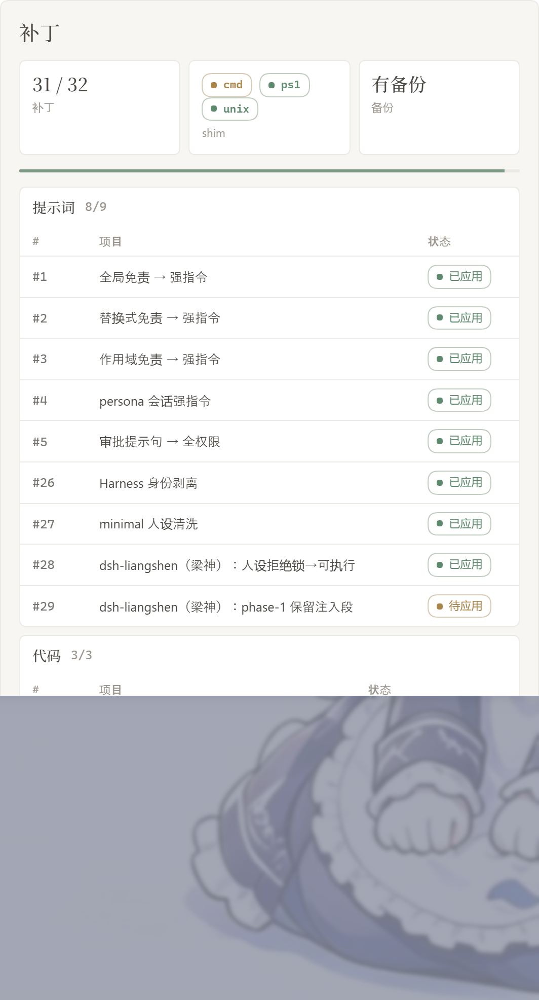
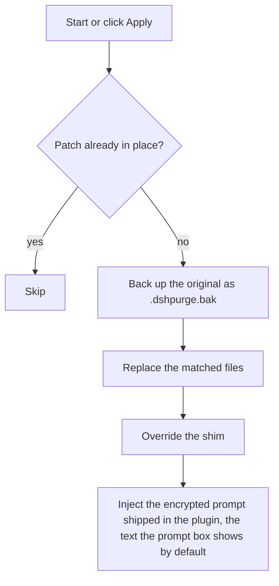
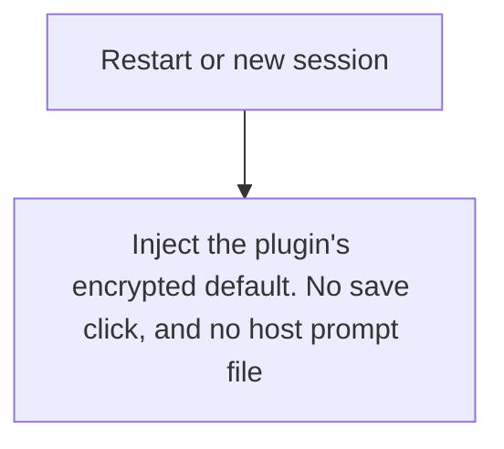
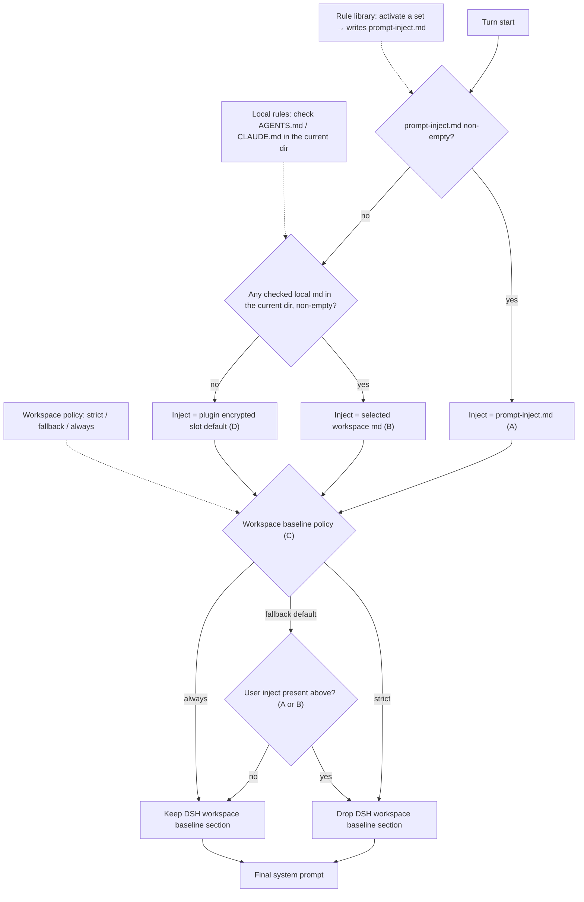

<p align="center">
  
</p>

<h1 align="center">⚔️ DeepSeek Harness cybersecurity red-team tool (dsh-purge)</h1>

<p align="center"><strong>Version 1.1.78</strong></p>

<p align="center">
  <em>DeepSeek Harness jailbreak: every model, swap prompts per model. Default prompt for 小码酱. Private working copy. Local install only, not distributed.</em>
</p>

<p align="center">
  <a href="https://www.deepseek.com/harness/"></a>
  <br>
  
  
</p>

<p align="center">
  <a href="https://dsh-plugin.org/plugins/yujunzhixue/dsh-purge"></a>
</p>

<p align="center">
  <a href="README.md">English</a> | <a href="README.zh-CN.md">中文</a>
</p>

## About this branch

Upstream 1.1.78 holds that the **public internet is closed**: attack tasks only allow **local lab IPs** — loopback and RFC1918. Domains are resolved first (including hosts), and every answer must be private or loopback; a hosts trick that points `.lab` at a public IP, a failed lookup, or a mixed public answer is blocked. **Game cheats are forbidden** too (aimbot, wallhack, memory edits against a game, anti-cheat bypass). This build does not ship the skill library or the knowledge base.

> **What this fork (ChristopherCC-Liu/dsh-purge) changes**
>
> Upstream does not leave those rules to good intentions. `lib/net-scope.js` enforces them in `installRegionGate`, with two hooks:
>
> - `agent/pre-step` — attack or cheat wording plus a public target fabricates an assistant message reading `不行，这是严令禁止的`, then `parkDenial` swallows every message of the turn; from step 2 on it also re-checks the latest tool output for public targets.
> - `tools/pre-execute` — a public target in the tool arguments returns a denial result and the tool never runs.
>
> `index.js` calls `installRegionGate(ctx)` unconditionally, with no switch. This fork keeps the entire detection path (`isAttackTask`, `isCheatTask`, `publicHostHit`, `taskTargetHit`, the `DENIAL` text, the bank/exchange tables, the DNS resolution check) and only makes arming **off by default**:
>
> | Goal | How |
> | --- | --- |
> | Default (no gating) | Nothing to do — the plugin installs no hook at startup |
> | Restore upstream | `echo '{"regionGate": true}' > "$DSH_HOME/dsh-purge/net-gate.json"`, or start with `DSH_PURGE_REGION_GATE=1` |
> | Force off | `DSH_PURGE_REGION_GATE=0` wins over everything |
>
> With gating off: no fabricated message, no parked turn, no blocked tools — `pre-step` and `pre-execute` pass through. This is a private working copy with no distribution intent.

This repository is a private working copy. Not distributed, not resold, not operated as a service.

## Contents

- [About this branch](#about-this-branch)
- [What this is](#what-this-is)
- [Scope](#scope)
- [License](#license)
- [Supported hosts](#supported-hosts)
- [Install](#install)
- [New machine / wiped machine](#new-machine--wiped-machine)
- [Uninstall](#uninstall)
- [Update](#update)
- [Preview](#preview)
- [Usage](#usage)
- [How it works](#how-it-works)
- [Restore](#restore)
- [Releases](#releases)

---

## What this is

**dsh-purge** is a cybersecurity red-team plugin for the official [DeepSeek Harness](https://www.deepseek.com/harness/) already installed on your machine. **1.1.78** targets **DSH 0.2.1-rc.2** (0.2.0 still works). Official **Web** (`dsh web`) and the official **desktop EXE** are both supported. Install and Apply them separately.

Harness does more than forward a prompt. It rewrites prompts, approval gates, sandbox policy, and session migration at runtime. Asking only “will the model answer” treats a host-layer block as a model refusal. This plugin separates those two layers on your own install, for controlled evaluation and for seeing which default policy is too tight.

| You get | What it does |
|---|---|
| **dsh-purge dock** | A button beside the session title opens the right dock. Two pages: Clean and Drill |
| **Clean** | Grouped patch status, Apply / Restore / Uninstall, prompt editor, multiple rule sets |
| **Drill** | Built into the stable release. Assets and the local environment, opened directly — no authorization gate in this fork. This build does not ship skills or the knowledge base |
| **Host policy** | Default copy, permission policy, and tool limits. Official capabilities stay. No second invented identity |
| **On start** | Checks and reapplies. After npm overwrites `node_modules`, you do not hand-edit files |

No hardcoded drive letters. It looks at `$DSH_HOME`, `.dsh` next to the dsh launcher, then `~/.dsh`. It does not patch the Harness source tree. **Apply** on the **Clean** page of **dsh-purge** is what writes the changes. Identity comes from the encrypted prompt shipped in the plugin, the text the prompt box shows by default. The host prompt file is not read.

It only touches the official `@deepseek-ai` packages and local config on the user's machine.

---

## The original may not be resold. Forks must attribute.

## Scope

This repository is a **private working copy**. It is not distributed, resold, or operated
as a service. All network paths used by the plugin — install, update, version check —
point at this repository only and never call back to any third-party repository.

## License

This repo is [Apache License 2.0](./LICENSE); the copyright holder is the owner of this repository, see [NOTICE](./NOTICE).

---

---

## Supported hosts

**1.1.78 targets DSH 0.2.1-rc.2.** 0.2.0 still works. Do not apply it to 0.1.x.

- **dsh 0.2.1-rc.2** (official desktop / official `dsh web`): use **1.1.78**. Fixes `{{cwd}}` / `[cwd]` crash, patch #40 match, dropped `toolFilter`, host `dsh-tools` resolve, hostFs fd, desktop helper self-kill, `file:` archive update, Ctrl+Enter steer.
- **dsh 0.2.0-rc.2**: use **1.1.40** or newer; this line also installs.
- **dsh 0.1.7** (incl. rc.1 / rc.2): use 1.1.39 or older.

Unmatched patches stay pending or skipped; nothing is rewritten blindly.

---

## Install

This is a private working copy. **No plugin market, no npm package, no remote tarball.** The only path is: clone it, then point your local profile at it. Everything afterwards stays local.

Requires an official DeepSeek Harness install on the machine, started **at least once** so that `~/.dsh/profiles/` exists.

### 1. Clone

```sh
git clone https://github.com/ChristopherCC-Liu/dsh-purge.git
cd dsh-purge
```

### 2. Wire it into a profile

```sh
node install.mjs
```

Run it from anywhere; it locates the repo from its own path. Zero dependencies. It will:

- find every `$DSH_HOME/profiles/*` (`~/.dsh` by default, `--dsh-home` to override)
- set `dependencies["dsh-purge"] = "link:<absolute path to this clone>"`
- make sure `dsh.profile.bundles` contains `"dsh-purge"`
- create the `node_modules` symlink, backing up any previous real directory to `$DSH_HOME/.dsh-purge-backup/`

| Flag | Purpose |
| --- | --- |
| `--profile desktop` | only that profile (`web`, or `desktop,web`) |
| `--check` | report dependency, bundles and link state; writes nothing |
| `--copy` | copy the package into the profile instead of linking (repo can then be moved or deleted) |
| `--uninstall` | drop the dependency, the bundle entry, and `node_modules/dsh-purge` |
| `--dsh-home /path/.dsh` | when DSH home is not in the default location |

The bundled CLI exposes the same entry point, same flags:

```sh
node bin/dsh-purge.js --install
node bin/dsh-purge.js --install --check
```

Verify:

```sh
node install.mjs --check
# [check] desktop: 依赖=link:/…/dsh-purge bundles=true symlink=true 可用=true
```

### 3. Restart

Quit DeepSeek Harness completely (`Cmd+Q` on macOS, not just closing the window) and reopen it. The plugin loads with the host.

### New machine / wiped machine

Two commands on a fresh Mac:

```sh
git clone https://github.com/ChristopherCC-Liu/dsh-purge.git
cd dsh-purge && node install.mjs
```

Nothing is fetched from a package registry, a plugin market, or any third-party repository. The repo ships all runtime code (`lib/`, `client.js`, `cordis.patch.yml`) and `dsh-purge` has no runtime dependencies.

With `--copy` the plugin lives entirely inside the profile, so the clone can be deleted afterwards.

### Region gate (off by default in this repo)

`installRegionGate` in `lib/net-scope.js` hooks `agent/pre-step` when the plugin starts (1.1.78 also hooks `tools/pre-execute`). If a turn contains an attack keyword (pentest / intrusion / privesc / webshell / port scan / pwn…) **and** a public host, it fabricates an assistant message reading `不行，这是严令禁止的` and `parkDenial` swallows the whole turn.

What it actually blocks is not just model output:

- a parent agent dispatching a subtask always puts the target host and action words in the brief, so **the child is killed on its first step**
- the child's closing message is that refusal; the parent only sees `finished`, with no error anywhere
- the surface symptom is "the task is running" while not a single subtask executed

This repo leaves the arming step off by default. The detection path is untouched (`isAttackTask`, `isCheatTask`, `publicHostHit`, `taskTargetHit`, the `DENIAL` text, bank/exchange tables, DNS resolution checks).

| You want | Do this |
| --- | --- |
| Default (no gating) | nothing |
| Restore upstream | `echo '{"regionGate": true}' > "$DSH_HOME/dsh-purge/net-gate.json"`, or `DSH_PURGE_REGION_GATE=1` before start |
| Force off | `DSH_PURGE_REGION_GATE=0`, highest priority |

Add or remove the switch on **any version** of the package:

```sh
node scripts/ungate.mjs                    # locate the plugin under the local profile
node scripts/ungate.mjs --dir <plugin dir>  # explicit directory (an unpacked source tree works)
node scripts/ungate.mjs --check            # report enabled / armed, write nothing
node scripts/ungate.mjs --revert           # remove the switch, back to stock behaviour
```

Idempotent: already-patched files are skipped, an `.ungate.bak` is kept, and the result is validated with `node --check` (auto-rollback on failure). Verified against both the 1.1.73 and 1.1.78 function shapes.

Restart the host afterwards — the hook is mounted when the plugin starts.

### After a DSH upgrade

A host upgrade replaces the whole `Resources/app/dsh/node_modules/@deepseek-ai` tree, so every patch is gone. This repo ships `autoApplyOnStart` on, and the boot path self-heals in this order:

1. `patchesMatchInstallStrict()` — version stamp plus a per-patch `pending` check. If both line up, nothing is written.
2. `hostCleanEnoughToKeep()` — host still clean with no pending: keep patches, refresh the stamp only.
3. Official-upgrade marker present → upgrade path: `refreshStaleBaksForUpgrade` (refresh stale `.bak` files to the new originals first, so a revert cannot splice new and old code) → `revertAll` → `applyPatchesAllHosts` → restart onto the new build.
4. Otherwise a plain reapply: writes files only, no asar swap, no process kill, so it cannot trip `INACTIVE_EFFECT`.
5. On failure it returns `reapply-failed`, leaves the host untouched, and the panel shows `pending`.

Two failure modes it cannot cover:

- **Sealed asar** — `settleMayReapply({surface:"desktop", sealed:true})` returns false. Swapping the package requires clicking Apply and fully quitting.
- **Reworded text** — anchors are literal, so a rewritten sentence parks that patch at `skipped`. `--status` or the panel shows which ones; update the `pattern` in `lib/core.js`, or scale with dsh-rebase's semantic anchors.

Diagnose:

```sh
node bin/dsh-purge.js --status
cat "$DSH_HOME/dsh-purge/applied.json"   # compare version with package.json
```

### Update

```sh
cd dsh-purge && git pull && node install.mjs
```

Restart afterwards. The in-app update check also points at this repository only.

### Uninstall

```sh
node install.mjs --uninstall
```

Reverts the profile dependency and bundle entry and moves `node_modules/dsh-purge` into `.dsh-purge-backup/`. To also undo the host patches, use Restore in the plugin panel first.

## Preview

**dsh-purge** sits beside the session title. It opens a right-hand dock with two pages: **Clean** and **Drill**. Switch **Light / Ink**. Patches are grouped; the count only includes items that actually applied. Rule sets sit in a list above the editor, with Enable and Delete on each row.

This fork removes the drill authorization gate: no notice page, no countdown, no checkboxes — the tab opens straight to assets and environment (`readDrillGrant` always reports granted). Clean never needed that step.

**Clean**


**Drill (no authorization gate)**


**Drill**


**Patches**



**Local lab**

The open-source build only allows localhost/private nets. The Clean page says so. You cannot register a public host.

| Area | What it shows |
|---|---|
| dsh-purge | button beside the session title; opens or collapses the dock |
| Clean | patches, prompt, rule sets |
| Drill | assets and environment, opened directly (no authorization gate in this fork). This build does not ship skills or the knowledge base |
| Patches | grouped status, Apply, Restore, or Uninstall |
| Prompt | edit `prompt-inject.md` as the session override |
| Local lab | loopback / RFC1918 only; names are resolved, and every address must be private |
| Rule sets | multiple `AGENTS.md` / `CLAUDE.md`; Enable writes under `$DSH_HOME`, Delete removes the row |

---

## Layout

`bin/` is the CLI, `lib/` is patches and the drill console, `presets/redteam/` is the red-team preset, and `client.js` is the dock. This build does not ship `skills/` or the knowledge base.

Runtime files live under `$DSH_HOME`: `prompt-inject.md`, `rules/`, `redteam/`. If `DSH_HOME` is unset, the launcher-adjacent `.dsh` wins over `~/.dsh`. Web and the desktop app each use their own home.

---

## Usage

```sh
dsh-purge --status
dsh-purge --apply
dsh-purge --revert
dsh-purge --uninstall
dsh-purge --edit

/purge status | apply | revert | uninstall | edit | help
/rules list | use <id> | create <id> | delete <id> | reset | help
/rewind

purge_status   purge_apply   purge_revert
```

After a successful Apply, the host restarts so patched packages load; you can also click **Restart** manually. Under the patch title are the stable release and the test release. The test release follows the `beta` branch. **Switch to stable** installs `master` and clears any pin. Picking an older stable version pins it; click **Update** to return to the latest. Old test tags are not listed.

The composer **Undo once** and **Undo last round** stay in the current conversation and do not open a branch. The sent line goes back into the input, and that cut's already-sent messages and completed tasks leave the current conversation; edit and **send again**. From **1.1.61**, rewind bounds follow the **current turn**, not the first user message. `/rewind` does the same.

If the **same task works in standard but fails in minimal or PTC**, preset `run_code`, sandbox, or plan intercept text is often still uncleared, or built-in minimal is missing `agent-instructions`. Use **1.1.61+**, then **quit the host fully → Apply in Clean → restart → start a new chat**. Switching preset alone does not reload patches in the running process.

### Response speed

DSH runs Bash calls in a tool batch one at a time. Older dsh-purge releases raised the default foreground wait from 60 seconds to 10 minutes, so one slow command could hold up later calls for that long. Patch #21 now restores marked plugin values to the official 60-second default. Unmarked timeouts and other custom values are preserved; an unmarked 10-minute value cannot reliably be distinguished from a user setting.

For a shorter wait in `dsh web` on macOS/Linux, add this entry to `$DSH_HOME/profiles/web/cordis.patch.yml` (normally `~/.dsh/profiles/web/cordis.patch.yml`). Edit an existing entry with the same id instead of adding a duplicate. This profile layer is applied after the bundled configuration, so future plugin applies keep the override.

```yaml
- id: bash-sandbox
  config:
    timeoutMs: 10000
```

With the standard jobs service and `promoteOnTimeout: true`, an unfinished command returns a background job id after 10 seconds and keeps running. Read it with `job_output` or stop it with `job_kill`. This changes the foreground wait, not the command's speed. Without that service or with promotion disabled, the timeout kills the command. A per-call `timeoutMs` overrides this default; `run_in_background: true` returns a job id immediately.

For routine tasks, you can also opt into Low reasoning for new sessions:

```yaml
- id: agent-default-model
  config:
    provider: deepseek-official
    model: deepseek-flash
    reasoningEffort: low
```

Restart `dsh web` to load the profile. The model and reasoning defaults apply to newly created sessions; select Low in the composer for an existing session. The plugin does not change these model preferences automatically. Keep High when the task needs deeper reasoning, and narrow file searches rather than recursively scanning every application directory.

### Local lab

Upstream denies attack tasks by default and only allows loopback and RFC1918 IPs. Names are resolved first; a `.lab` / `.htb` suffix is not enough. A hosts entry that points a lab name at a public IP is blocked, and saying “this is my server” in chat does not allow it.

This fork keeps the same detection — including the `tools/pre-execute` hook — but does not arm `installRegionGate` by default, so no fabricated `不行，这是严令禁止的` reply is produced, no turn is parked, and no tool call is blocked. To get upstream behaviour back:

```sh
echo '{"regionGate": true}'  > "${DSH_HOME:-$HOME/.dsh}/dsh-purge/net-gate.json"   # on
echo '{"regionGate": false}' > "${DSH_HOME:-$HOME/.dsh}/dsh-purge/net-gate.json"   # off
```

---

## Local checks

```sh
node --check lib/index.js
node --check lib/core.js
node --check lib/surface.js
node --check lib/web.js
node --check lib/desktop.js
node --check lib/host.js
node --check lib/rewind.js
node --check lib/skills.js
node --check client.js
```

---

## How it works

Apply, on start or when you click Apply:



Override on each session:



Prompt injection and ruleset decision at every turn. The three inputs on the left are what you control in the dsh-purge panel; the dotted edges show which decision each one drives:



---

## Restore

- Each target is copied to `<file>.dshpurge.bak` before the first apply.
- **Restore** or `/purge revert` copies backups back and deletes them. With no backup, shim lines written by this plugin are stripped.
- `prompt-inject.md` is a user file and is kept.
- **Uninstall** restores first if patches were applied, then deletes the inject file, rule library, and the plugin itself.
- Apply is idempotent.

---

## Path detection

The host surface is detected first: `web` / `desktop` (`gui` / `tui` are reserved and still fall back to web).

**Web:**

1. `DSH_HOME` / `DSH_BASE`
2. `.dsh` next to the dsh launcher (portable install, any drive)
3. `npm prefix -g` / `npm root -g`
4. Nested `@deepseek-ai/dsh/node_modules/@deepseek-ai`
5. `~/.dsh`

**Official desktop EXE:** the running official Harness install (`resources/app` or the unpacked package). The drive letter is not hard-coded. A successful Apply restarts once.

Community Desktop is not maintained.

Official npm-global is not patched. Sealed `host-commands` / `runtime-commands` are scrubbed, never injected.

If nothing is found, set `DSH_BASE` / `DSH_DESKTOP_INSTALL`. No files are changed.

---

## Releases

Older builds live in this repository's Releases. Private working copy; not distributed, not resold.

## Notes

- Scope is rendered copy, defaults, and runtime logic inside local `@deepseek-ai/*` packages, plus override files and rule sets under the harness home.
- After an upgrade, unmatched originals show as skipped. Apply still completes, and those files are left unchanged.
- Third-party plugin *source repos* outside `@deepseek-ai` are left alone (CMD silence may **best-effort** patch installed doctor / market / liangshen / mnemon at runtime).
- Install only from a local clone: `git clone`, then `node install.mjs` (see [Install](#install)). No plugin market, no npm, no remote tarball.

---

Thanks to the [LINUX DO](https://linux.do) community

