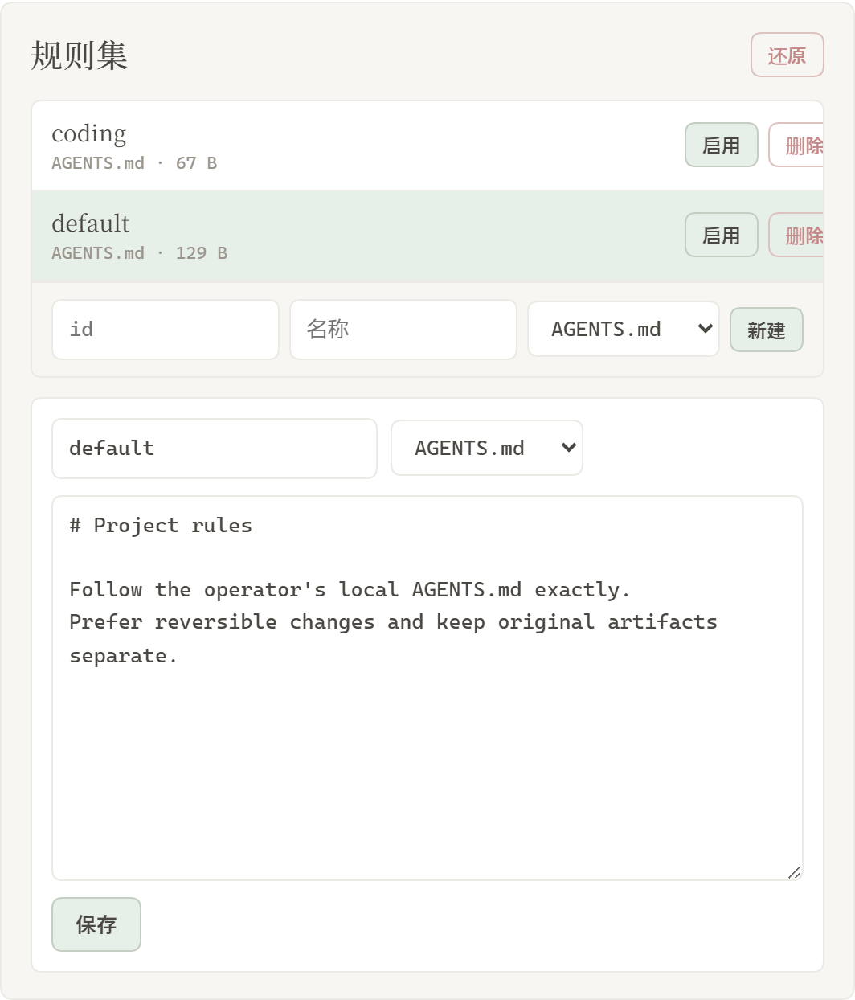
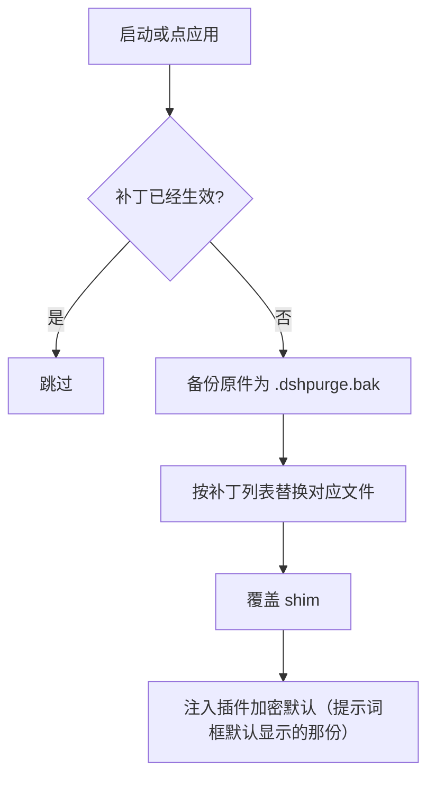
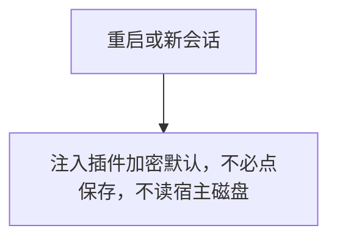
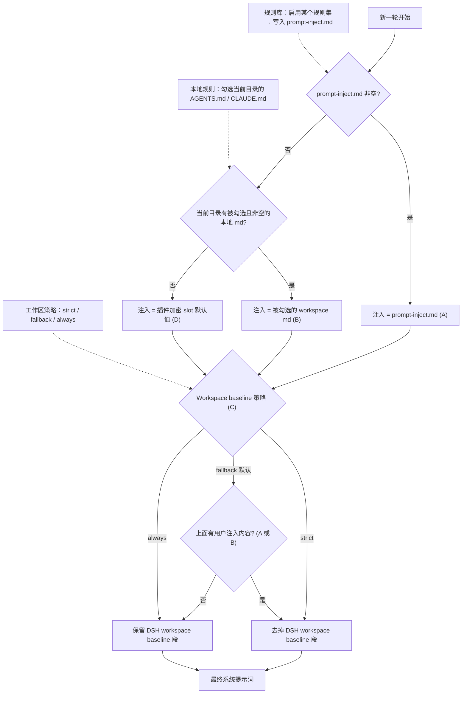

<p align="center">
  
</p>

<h1 align="center">⚔️ DeepSeek Harness 网络安全红队工具（dsh-purge）</h1>

<p align="center"><strong>Version 1.1.78</strong></p>

<p align="center">
  <em>DeepSeek Harness 破甲：让所有模型都能破甲，不同模型可换不同提示词；默认提示词面向国模「小码酱」。Jailbreak for every model — swap prompts per model. 自用分支，仅本地安装，不分发</em>
</p>

<p align="center">
  <a href="https://www.deepseek.com/harness/"></a>
  <br>
  
  
</p>

<p align="center">
  <a href="https://dsh-plugin.org/plugins/yujunzhixue/dsh-purge"></a>
</p>

<p align="center">
  <a href="README.md">English</a> | <a href="README.zh-CN.md">中文</a>
</p>

## 本分支说明

上游 1.1.78 的立场是：**公网一律不许碰**。攻击任务只认**本地靶场 IP**——本机回环和 RFC1918 私网；域名先按系统解析（含 hosts），解析到的每一个地址都必须是私网或回环，hosts 把 `.lab` 指到公网、解析失败、混有公网地址一律拦。同时**禁止制作外挂**（自瞄、透视、改内存打游戏、过反作弊）。开源版不下发技能库和知识库。

> **本 fork（ChristopherCC-Liu/dsh-purge）的差异**
>
> 上面这两条在上游不是靠自觉，是靠 `lib/net-scope.js` 的 `installRegionGate` 硬执行的，而且挂了两条钩子：
>
> - `agent/pre-step`：命中攻击词 / 外挂词且有公网目标 → 直接伪造一条 `不行，这是严令禁止的` assistant 消息，再用 `parkDenial` 把整轮 messages 吞掉，模型没有开口的机会；step > 1 还会继续查最新工具输出里的公网目标。
> - `tools/pre-execute`：工具参数里出现公网目标 → 直接返回拒绝结果，工具根本不执行。
>
> `index.js` 里 `installRegionGate(ctx)` 是无条件调用，没有任何开关。本 fork 保留完整判定链路（`isAttackTask` / `isCheatTask` / `publicHostHit` / `taskTargetHit`、`DENIAL` 文案、银行与交易所名单、DNS 解析校验全部原样不动），只把 arm 这一步变成**默认关闭**：
>
> | 目标 | 做法 |
> | --- | --- |
> | 默认（不拦） | 不动任何文件，插件启动即不装 hook |
> | 恢复上游行为 | `echo '{"regionGate": true}' > "$DSH_HOME/dsh-purge/net-gate.json"`，或启动前 `DSH_PURGE_REGION_GATE=1` |
> | 强制关闭 | `DSH_PURGE_REGION_GATE=0`，优先级最高 |
>
> 关闭后：不伪造消息、不 park 回合、不拦工具，`pre-step` 与 `pre-execute` 原样放行。这是自用副本，不含对外分发意图。

本仓库为自用分支，不分发、不收费、不代运营。

## 目录

- [本分支说明](#本分支说明)
- [介绍](#介绍)
- [使用范围](#使用范围)
- [许可证](#许可证)
- [适配范围](#适配范围)
- [安装](#安装)
- [换机 / 重装](#换机--重装)
- [更新](#更新)
- [界面](#界面预览)
- [使用](#使用)
- [工作原理](#工作原理)
- [还原](#还原)
- [更新](#更新)

---

## 介绍

**dsh-purge** 是装在本机官方 [DeepSeek Harness](https://www.deepseek.com/harness/) 上的网络安全红队评测插件。当前 **1.1.78** 已适配 **DSH 0.2.1-rc.2**（0.2.0 仍可用）。官方 **Web**（`dsh web`）和官方 **桌面端**（EXE）都支持，两边分开装、分开应用。

Harness 不只是把问题交给模型。它还会在运行时改提示词、审批门、沙箱和会话格式。只看「模型答不答」，会把宿主拦截误当成模型拒绝。这个插件在你自己的安装里把这两层分开，用来做受控评测，也用来看默认策略该不该收紧。

| 你会用到             | 它做什么                                            |
| ---------------- | ----------------------------------------------- |
| **dsh-purge 侧栏** | 会话标题旁的按钮打开右侧栏。里面两页：清洗、演练台                       |
| **清洗**           | 分组查看补丁，应用、还原、卸载；编辑提示词和多套规则                      |
| **演练台**          | 正式版内置。直接进资产和环境页，无授权门。开源版不下发技能库和知识库 |
| **宿主策略**         | 调整默认文案、权限策略和工具上限。官方能力保留，不另写一套身份                 |
| **启动时**          | 自动再检查并应用。npm 升级盖掉 `node_modules` 之后不用手改文件       |

不写死盘符。按 `$DSH_HOME`、dsh 启动器旁边的 `.dsh`，再退回 `~/.dsh`。不改 Harness 源码仓库，在 **dsh-purge** 的「清洗」里点「应用」才写入。身份来自插件里的加密提示词，也就是提示词框默认显示的那一份。不读取宿主磁盘上的提示词文件。

本插件只处理使用者本机已安装的官方 `@deepseek-ai` 包和本机配置。

---

## 📌 原版不允许倒卖。二开必须署名。

## 使用范围

本仓库是**自用工作副本**，不对外分发、不收费、不代运营。代码归本仓库所有者自行维护，
上游来源仅作技术参考；更新、安装、检查更新等所有网络路径都指向本仓库自身，不回连任何第三方仓库。

## 许可证

本仓库使用 [Apache License 2.0](./LICENSE)，版权人为本仓库所有者，见 [NOTICE](./NOTICE)。

---

---

## 适配范围

**1.1.78 已适配 DSH 0.2.1-rc.2**，0.2.0 仍可用。不要拿它去打 0.1.x。

- **dsh 0.2.1-rc.2**（官方桌面 / 官方 `dsh web`）：用 **1.1.78**。已修 `{{cwd}}` / `[cwd]` 整轮失败、补丁 #40 命中、`toolFilter` 废弃、`dsh-tools` 解析、hostFs fd、桌面换包自杀、`file:` 归档更新、Ctrl+Enter 插话。
- **dsh 0.2.0-rc.2**：用 **1.1.40** 及以上；本页这档也能装。
- **dsh 0.1.7**（含 rc.1 / rc.2）：用 1.1.39 及更早版本。

对不上的补丁会显示待应用或跳过，不会乱改文件。

---

## 安装

本仓库是自用分支，**不走插件市场、不走 npm、不拉远程压缩包**。唯一路径是 clone 到本机，再把本机 profile 指过来；装完之后所有更新都在本地完成。

前提：本机已装官方 DeepSeek Harness，并且**至少启动过一次**（它会生成 `~/.dsh/profiles/`）。

### 1. 拉仓库

```sh
git clone https://github.com/ChristopherCC-Liu/dsh-purge.git
cd dsh-purge
```

### 2. 接进 profile

```sh
node install.mjs
```

脚本零依赖，自动做完这些事：

- 找到 `$DSH_HOME/profiles/*`（默认 `~/.dsh`，可用 `--dsh-home` 指定）
- 把 profile 里 `dependencies["dsh-purge"]` 写成 `link:<本仓库绝对路径>`
- 确保 `dsh.profile.bundles` 里有 `"dsh-purge"`
- 在 `node_modules/` 里落一个指向本仓库的符号链接；原来是实体目录的，先备份到 `$DSH_HOME/.dsh-purge-backup/`

常用参数：

| 参数 | 用途 |
| --- | --- |
| `--profile desktop` | 只接桌面端（也能写 `web` 或 `desktop,web`） |
| `--check` | 只报告依赖、bundles、链接状态，不写任何文件 |
| `--copy` | 复制一份进 profile，不依赖仓库路径（仓库可随意移动/删除） |
| `--uninstall` | 撤掉依赖、bundles 条目与 `node_modules/dsh-purge` |
| `--dsh-home /path/.dsh` | DSH 主目录不在默认位置时用 |

接成功的标志：

```sh
node install.mjs --check
# [check] desktop: 依赖=link:/…/dsh-purge bundles=true symlink=true 可用=true
```

### 3. 重启

完全退出 DeepSeek Harness（macOS 上 `Cmd+Q`，不是关窗口），再打开。插件随宿主启动加载。

### 换机 / 重装

本机被清空后，在新 Mac 上重复两步即可：

```sh
git clone https://github.com/ChristopherCC-Liu/dsh-purge.git
cd dsh-purge && node install.mjs
```

不需要联网装包、不需要插件市场、不需要任何第三方仓库。仓库自带全部运行代码（`lib/`、`client.js`、`cordis.patch.yml`），`dsh-purge` 本身没有运行时依赖。

用 `--copy` 装的话，仓库删掉也不影响，插件已在自己 profile 里。

### 更新

```sh
cd dsh-purge && git pull && node install.mjs
```

重启宿主后生效。App 里「检查更新」也已指向本仓库，不会再回头拉别处的包。

### 卸载

```sh
node install.mjs --uninstall
```

改回 profile 的依赖与 bundles 条目，`node_modules/dsh-purge` 移入 `.dsh-purge-backup/`。要彻底移除插件对宿主的补丁，再用 App 里「还原」或在插件面板点「还原」。

## 界面预览

会话标题旁有 **dsh-purge**。点开是右侧栏，两页：**清洗** 和 **演练台**。白 / 墨可切换。补丁按组展开，进度只计真正已应用的项。规则集在上方列表启用或删除，下方编辑正文。

本 fork 去掉了演练台的授权门：没有声明页、没有倒计时、没有勾选，打开即进资产与环境页（后端 `readDrillGrant` 恒返回已授权）。清洗本来就不需要这一步。

**清洗**


**演练台（已无授权门）**


**演练台**


**补丁**


**规则集**



**本地靶场**

上游只放行本机/内网，清洗页会写明这一点。本 fork 保留判定但默认不强制；要恢复限制见上文「本 fork 的差异」。

| 区域        | 说明                                                                                                         |
| --------- | ---------------------------------------------------------------------------------------------------------- |
| dsh-purge | 会话标题旁的按钮，打开或收起右侧栏                                                                                          |
| 清洗        | 补丁、提示词、规则集                                                                                                 |
| 演练台       | 资产与环境页，直接可进（本 fork 去掉授权门）。开源版不下发技能库和知识库                                                                     |
| 补丁        | 分组查看状态，应用、还原或卸载                                                                                            |
| 提示词       | 编辑 `prompt-inject.md`，作为会话覆盖段                                                                              |
| 本地靶场      | 上游：只放行本机/私网 IP，域名先解析且全部地址必须是私网或回环。本 fork：判定保留，默认不强制，`net-gate.json` 可恢复 |
| 规则集       | 多套 `AGENTS.md` / `CLAUDE.md`；启用写入 `$DSH_HOME`，删除从列表去掉                                                      |

---

## 目录结构

`bin/` 是命令行，`lib/` 是补丁和演练台，`presets/redteam/` 是红队预设，`client.js` 是侧栏。开源版不下发 `skills/` 和知识库。

运行时文件在 `$DSH_HOME`：`prompt-inject.md`、`rules/`、`redteam/`。未设 `DSH_HOME` 时，优先用 dsh 安装目录旁边的 `.dsh`，再退回 `~/.dsh`。Web 和桌面端各用自己那一份主目录。

---

## 使用

```sh
# CLI
dsh-purge --status
dsh-purge --apply
dsh-purge --revert
dsh-purge --uninstall
dsh-purge --edit

# 聊天
/purge status | apply | revert | uninstall | edit | help
/rules list | use <id> | create <id> | delete <id> | reset | help
/rewind

# 模型工具
purge_status   purge_apply   purge_revert
```

设置页「应用」成功后会自动重启，以加载已改的包文件；也可手动点「重启」。补丁标题下有正式版和测试版。测试版跟 `beta` 分支。点「切换到正式版」会装回 master，并清掉钉选。正式版里选旧版本会固定在该版本，要回到最新再点「更新」。旧的测试标签不再列出。

输入框旁的「回退一次」和「回退上一轮」都留在当前这条对话里，不另开分支。已发送的那句会回到输入框，这一轮已经发出的内容和已完成的任务会从当前对话撤掉，改字后**重新发送**即可。从 **1.1.61** 起，多轮对话后回退按**当前这一轮**定位，不会又退到第一条用户消息。聊天里 `/rewind` 同样可用。

**极简 / PTC 与标准不一致时**：同一任务在标准模式能跑、在极简或 PTC 被拦，通常是 preset 里 `run_code` 或 plan 拦截句没洗净，或内置 minimal 缺少 `agent-instructions`。请升到 **1.1.61+**，**完全退出宿主 → 清洗里应用 → 自动重启 → 新开一轮对话** 再试；只换 preset 不重应用，旧进程里的补丁不会更新。

### 响应速度

DSH 会按顺序执行同一批中的 Bash 调用。旧版 dsh-purge 把默认前台等待从 60 秒提高到了 10 分钟，一条慢命令会让后续调用一起等待。补丁 #21 现在把带插件标记的旧值恢复为官方的 60 秒。无标记的等待时间和其他自定义值会保留；无标记的 10 分钟无法可靠地区分是插件旧值还是用户设置。

在 macOS/Linux 的 `dsh web` 中，如需更快返回工具结果，可在 `$DSH_HOME/profiles/web/cordis.patch.yml`（通常是 `~/.dsh/profiles/web/cordis.patch.yml`）添加下面的条目。已有相同 id 时修改原条目，不要重复添加。这个 profile 覆盖层在内置配置之后加载，后续应用插件会保留它。

```yaml
- id: bash-sandbox
  config:
    timeoutMs: 10000
```

使用标准 jobs 服务且 `promoteOnTimeout: true` 时，未完成的命令会在 10 秒后返回后台任务 id，并继续运行。用 `job_output` 读取结果、用 `job_kill` 停止。这个设置缩短前台等待，不会让命令本身跑得更快。没有 jobs 服务或关闭自动转后台时，超时会终止命令。单次调用传入的 `timeoutMs` 优先于这里的默认值；`run_in_background: true` 可立即返回任务 id。

日常任务还可以选择让新会话默认使用 Low 推理：

```yaml
- id: agent-default-model
  config:
    provider: deepseek-official
    model: deepseek-flash
    reasoningEffort: low
```

重启 `dsh web` 后加载配置。模型和推理等级默认值只用于新建会话，已有会话请在输入框中选择 Low。插件不会自动修改这些模型偏好。需要深入推理的任务可保留 High；搜索文件时应限定目录，避免递归扫描所有应用目录。

### 本地靶场

上游默认全拦：只放行本机/私网 IP，域名先解析再判，不认 `.lab` / `.htb` 这类后缀本身，hosts 把实验室名指到公网 IP 也拦，在对话里说「这是我的服务器」不会放行。

本 fork 保留同一套判定（含 `tools/pre-execute` 那条工具钩子），但 `installRegionGate` 默认不 arm，所以不会出现「不行，这是严令禁止的」这种替身回复，不会吞回合，也不会拦工具调用。要回到上游行为：

```sh
echo '{"regionGate": true}'  > "${DSH_HOME:-$HOME/.dsh}/dsh-purge/net-gate.json"   # 打开
echo '{"regionGate": false}' > "${DSH_HOME:-$HOME/.dsh}/dsh-purge/net-gate.json"   # 关闭
```

---

## 本地校验

```sh
node --check lib/index.js
node --check lib/core.js
node --check lib/rewind.js
node --check lib/skills.js
node --check client.js
```

---

## 工作原理

应用，启动时或手动点「应用」：



每次会话的覆盖：



每一轮的提示词注入与规则集决策。左边三个输入就是你在 dsh-purge 面板里控制的东西，虚线表示它们各自驱动哪一步判定：



---

## 还原

- 每个目标文件在应用前备份为 `<文件>.dshpurge.bak`。
- 「还原」或 `/purge revert` 用备份覆盖回去并删除备份；没有备份时去掉 shim 里由本插件写入的行。
- `prompt-inject.md` 是用户文件，还原时保留。
- 「卸载」会先还原（若已应用），再删除注入文件、规则库和插件本身。
- 重复应用是幂等的。

---

## 路径探测

宿主面先判断 `web` / `desktop`（预留 `gui` / `tui`，尚未单独适配时回退 web）。

**Web：**

1. `DSH_HOME` / `DSH_BASE`
2. dsh 启动器旁的 `.dsh`
3. `npm prefix -g` / `npm root -g`
4. 嵌套 `@deepseek-ai/dsh/node_modules/@deepseek-ai`
5. 系统默认 `~/.dsh`

**官方桌面：** 只改当前正在运行的官方桌面安装。点「应用」成功后会自动重启一次。社区桌面端不维护。

找不到目标时提示设置 `DSH_BASE`，不改文件。

---

## 更新

历史版本见本仓库 Releases。本仓库为自用分支，不分发、不收费。

## 说明

- 改动范围是本机 `@deepseek-ai/*` 包里的渲染文案、默认策略和执行逻辑，以及用户目录下的覆盖文件与规则集。
- 升级后原文对不上会显示跳过，这次应用仍算完成，不会乱改。
- 不改动非 `@deepseek-ai` 的第三方插件源仓库（启动时的 CMD 无感会**尽力**修补已装的 doctor / market / 梁神 / mnemon，属运行时补丁）。
- 安装只走本地 clone：`git clone` 后 `node install.mjs`（见 [安装](#安装)）。不经过插件市场、npm 或远程压缩包。

---

感谢 [LINUX DO](https://linux.do) 社区
